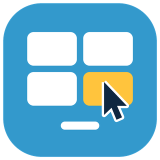

# ioBroker.desktop-control

[](https://www.npmjs.com/package/iobroker.desktop-control)
[](https://www.npmjs.com/package/iobroker.desktop-control)


[](https://nodei.co/npm/iobroker.desktop-control/)

**Tests:** 

## desktop-control adapter for ioBroker

Controls Windows PCs from ioBroker: popups, programs, audio, text-to-speech, screenshots, power, keyboard/mouse and more. On each PC runs the small **WinCtl** agent (a single exe, no installer); adapter and agent talk via **MQTT**.

The agent describes itself: it publishes all its commands, parameters and states as a manifest, and the adapter creates the data points from it. New agent commands therefore appear without an adapter update.

## Requirements

- An MQTT broker (e.g. Mosquitto or the ioBroker MQTT adapter in broker mode)
- The WinCtl agent on every PC to control, connected to the same broker

## Setup

1. Start the agent on the PC and enter broker, user/password and (optionally) the device id in its settings dialog.
2. In the adapter settings enter the same broker and the same topic base (default `winctl`).
3. Each PC appears as a device as soon as it connects.

## Data points per PC

| Data point | Description |
|---|---|
| `online` | Agent connected |
| `info.*` | Host name, IP, agent version, OS, user, start time, allowed programs |
| `state.*` | Values reported by the agent (locked, user present, idle time, active window, volume, CPU, RAM, battery, drives, watched processes, …). `volume`, `muted` and `keep_awake` are writable. |
| `cmd.*` | One data point per command: a button for commands without required parameters, otherwise JSON (`{"text":"Hello"}`) or the plain value of the main parameter (`Hello`) |
| `event.*` | Events like `lock`, `unlock`, `hotkey` |
| `result` | Result of the last command |
| `screenshot` | Path of the last screenshot in the ioBroker file storage |

`all.cmd.*` sends a command to all PCs at once.

Dangerous commands (e.g. `shell`) and commands switched off in the agent get no data point. They can only be sent via `sendTo`.

## Scripts (sendTo)

```js
// command to one PC (device id or host name), the answer is the result of the agent
sendTo('desktop-control.0', 'cmd', { device: 'office-pc', command: 'speak', params: { text: 'Dinner is ready' } }, res => log(JSON.stringify(res)));

// short form for the main parameter
sendTo('desktop-control.0', 'cmd', { device: 'office-pc', command: 'volume', params: 30 });

// question with buttons, waits for the answer (ask timeout from the settings)
sendTo('desktop-control.0', 'cmd', {
    device: 'living-room',
    command: 'ask',
    params: { text: 'Start movie mode?', buttons: ['Yes', 'No'], timeout: 30 },
}, res => log(res.result && res.result.button));

// all PCs, list of devices
sendTo('desktop-control.0', 'cmd', { device: 'all', command: 'lock' });
sendTo('desktop-control.0', 'devices', {}, list => log(JSON.stringify(list)));
```

The answer has the form `{ ok, command, result, error }`.

## Security

Whoever may write to `winctl/+/cmd/#` controls the PC. Secure the broker with user/password and ACLs, use TLS if needed. By default the agent only starts programs from its alias list and `shell` is off.

## Changelog
<!--
	Placeholder for the next version (at the beginning of the line):
	### **WORK IN PROGRESS**
-->
### **WORK IN PROGRESS**
* (ipod86) initial release

Older changelogs are available in [CHANGELOG_OLD.md](CHANGELOG_OLD.md).

## License
MIT License

Copyright (c) 2026 David <david@graef.email>

Permission is hereby granted, free of charge, to any person obtaining a copy
of this software and associated documentation files (the "Software"), to deal
in the Software without restriction, including without limitation the rights
to use, copy, modify, merge, publish, distribute, sublicense, and/or sell
copies of the Software, and to permit persons to whom the Software is
furnished to do so, subject to the following conditions:

The above copyright notice and this permission notice shall be included in all
copies or substantial portions of the Software.

THE SOFTWARE IS PROVIDED "AS IS", WITHOUT WARRANTY OF ANY KIND, EXPRESS OR
IMPLIED, INCLUDING BUT NOT LIMITED TO THE WARRANTIES OF MERCHANTABILITY,
FITNESS FOR A PARTICULAR PURPOSE AND NONINFRINGEMENT. IN NO EVENT SHALL THE
AUTHORS OR COPYRIGHT HOLDERS BE LIABLE FOR ANY CLAIM, DAMAGES OR OTHER
LIABILITY, WHETHER IN AN ACTION OF CONTRACT, TORT OR OTHERWISE, ARISING FROM,
OUT OF OR IN CONNECTION WITH THE SOFTWARE OR THE USE OR OTHER DEALINGS IN THE
SOFTWARE.